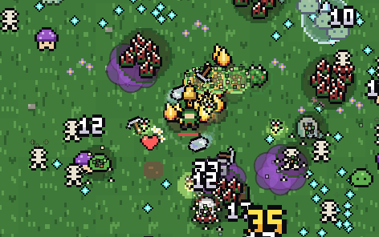

<!-- README drž krátké. Podrobnosti o nových věcech patří do docs/PODROBNOSTI.md. -->
# RuGee

Survivors hra v prohlížeči, jde i na mobilu. Přidáš si ji na plochu a hraje se i bez internetu. Ty se jen hýbeš, zbraně střílí samy a hordy nepřátel nekončí. Vydržíš co nejdéle?

### ▶ [Hrát](https://kojdad-alt.github.io/RuGee/)

[](https://kojdad-alt.github.io/RuGee/)

## Co tě čeká

- **14 zbraní**, od Jiskry a Lucerny po Cep na řetězu a Odrazný kámen. Úrovně nemají strop.
- **Bossové každé 3 minuty.** Dupou, hází kameny, dělají výpady a vyvolávají pomocníky. Po nich zůstane truhla s výbavou.
- **Hrozba** roste každou minutu a od 5. minuty chodí elity.
- **6 map**: Louka, Jeskyně hlubin, Zamrzlé jezero, Sopka, Bažina a Hřbitov za noci. Každá má svého bosse a svoje nástrahy.
- **4 postavy**: Lovec, Havíř, Světlonoš a Bouřlivák.
- **Zlaťáky** na kupce, přehazování karet a zamčené truhly. Z **duší** si koupíš trvalá vylepšení.
- **Zvuky a hudba** ze syntezátoru, každá mapa má svou náladu. Hlasitost je v Nastavení, N ztlumí.
- **Až 5 profilů** na jednom zařízení. Uložení přeneseš jinam kódem nebo souborem, bez serveru.

## Ovládání

| | |
|---|---|
| Pohyb | WASD nebo šipky, na mobilu tah prstem |
| Výběr karty | 1–3 nebo klik |
| Přehodit karty | R |
| Pauza | P |

## Pro vývojáře

Čisté HTML, CSS a JavaScript, bez build kroku.

```bash
python3 -m http.server 8000      # pak http://localhost:8000
node tests/simulace.mjs 1 600    # simulace hry bez prohlížeče
node nastroje/verze.mjs          # po každé změně kódu (otisky proti cache)
```

Jak všechno funguje do detailu: [docs/PODROBNOSTI.md](docs/PODROBNOSTI.md).
