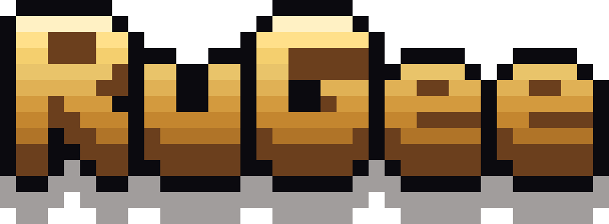
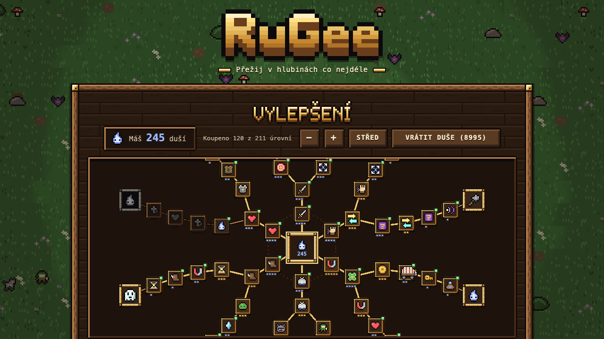
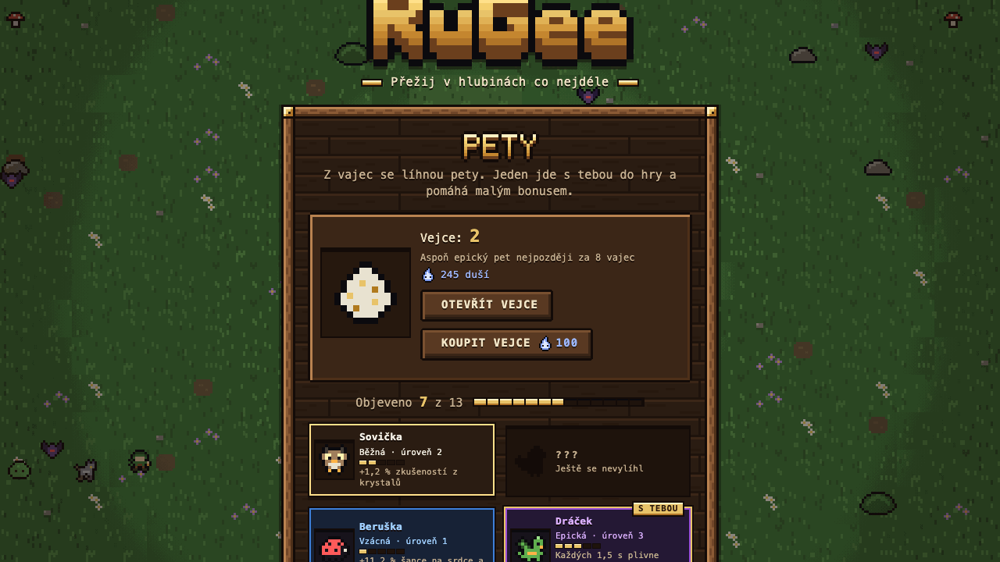
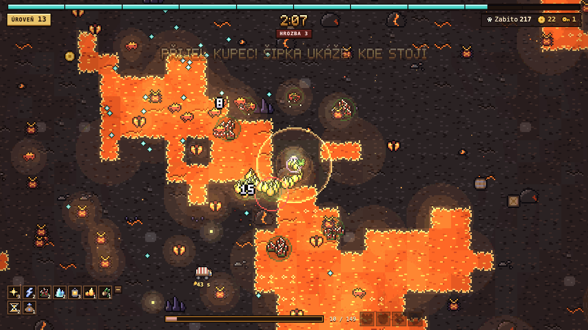

<!-- README drž krátké (do 40 řádků). Podrobnosti o nových věcech patří do docs/PODROBNOSTI.md. -->
<h1 align="center"><a href="https://kojdad-alt.github.io/RuGee/"></a></h1>

<p align="center"><b>Survivors hra v prohlížeči.</b> Ty se jen hýbeš, zbraně střílí samy a hordy nepřátel nekončí. Vydržíš co nejdéle?<br>Jde i na mobilu nebo s ovladačem, přidáš si ji na plochu a hraje se i bez internetu.</p>

<h3 align="center"><a href="https://kojdad-alt.github.io/RuGee/">▶ Hrát zdarma v prohlížeči</a></h3>

<p align="center"><a href="https://kojdad-alt.github.io/RuGee/"></a></p>
<p align="center">  </p>

## Co tě čeká

- **14 zbraní**, od Jiskry a Lucerny po Cep na řetězu a Odrazný kámen. Úrovně nemají strop.
- **6 map a každá má vlastní tvory**: na Louce včely a strašáci, v Jeskyni permoníci, na jezeře sněhuláci, na Sopce salamandři a čertíci, v Bažině vodníci, na Hřbitově ghúlové a hrobníci.
- **Bossové každé 3 minuty.** Dupou, hází kameny, dělají výpady a vyvolávají pomocníky. Po nich zůstane truhla s výbavou.
- **Hrozba** roste každou minutu, od 5. minuty chodí elity a kdo stojí na místě, toho nepřátelé obklíčí.
- **Strom vylepšení** se 72 uzly: za duše z každé výpravy si koupíš trvalou sílu a odemkneš klíčové uzly.
- **Pety z vajec**: 13 mazlíčků od sovičky po dráčka, který plive oheň. Jeden jde s tebou do hry.
- **4 postavy** (Lovec, Havíř, Světlonoš, Bouřlivák), **zlaťáky** na kupce a zamčené truhly.
- **Zvuky a hudba** ze syntezátoru, **až 5 profilů** s přenosem kódem nebo souborem.
- **Česky i anglicky** (English) a s **režimem pro barvoslepé**, obojí přepneš v Nastavení.

## Ovládání

| | |
|---|---|
| Pohyb | WASD, šipky nebo páčka ovladače, na mobilu tah prstem |
| Výběr karty | 1–3 nebo klik, R přehodí nabídku |
| Pauza | P nebo Esc |

## Pro vývojáře

Čisté HTML, CSS a JavaScript, bez build kroku. [](https://github.com/kojdad-alt/RuGee/actions/workflows/testy.yml)
```bash
python3 -m http.server 8000      # pak http://localhost:8000
node tests/simulace.mjs 1 600    # simulace hry bez prohlížeče
node nastroje/verze.mjs          # po každé změně kódu (otisky proti cache)
```

Jak všechno funguje do detailu: [docs/PODROBNOSTI.md](docs/PODROBNOSTI.md).
