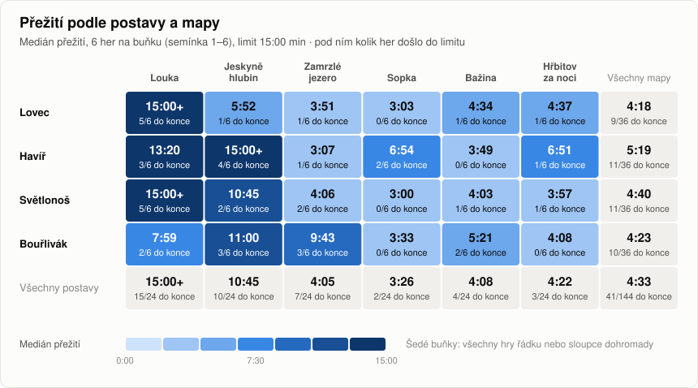
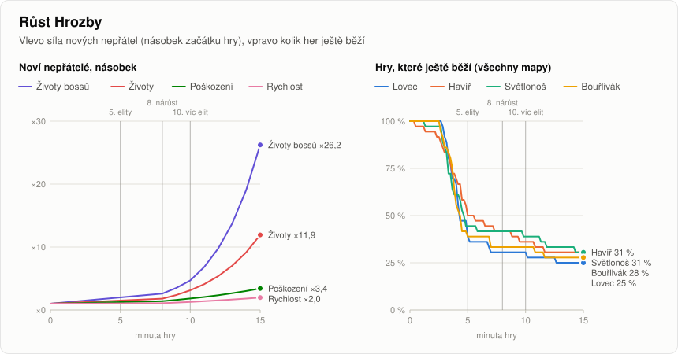
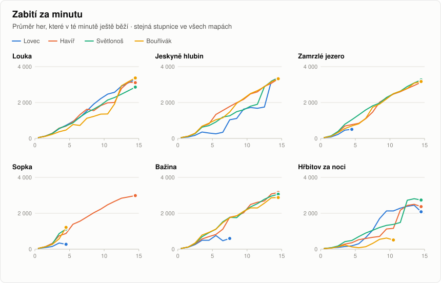
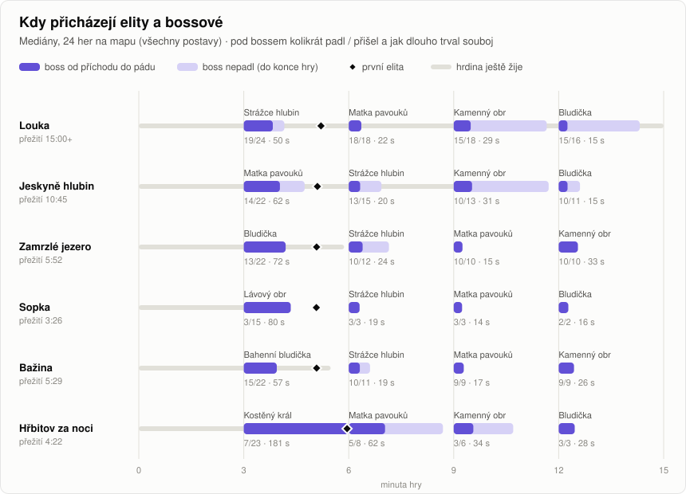

<!-- Vygenerováno nástrojem nastroje/balanc.py, ručně neupravovat (přepíše se). -->
# Balanc RuGee

Stejný bot jako v testu (`tests/simulace.mjs`) hraje bez trvalých vylepšení za každou postavu na každé mapě,
6 her na kombinaci (semínka 1–6), nejdéle 15:00 min. Bot není člověk:
utíká, sbírá krystaly a bere nejdřív zbraně. Čísla proto ukazují poměry mezi postavami a mapami, ne přesně,
jak dlouho vydrží hráč. Níž jsou jen fakta z dat, „lehké“ a „těžké“ se počítá podle pravidel v závorkách.

144 her · otisk kódu `9b8fbced` · znovu: `python3 nastroje/balanc.py --seminek 6 --sekund 900` (podrobnosti v
[PODROBNOSTI.md](PODROBNOSTI.md#balanc))

## Přežití

- Žádná kombinace postavy a mapy nedošla do limitu 15:00 ve všech hrách.
- **Moc těžké pro bota** (medián přežití pod 5 min, tedy dřív, než přijdou elity): Lovec – Zamrzlé jezero 3:51, Lovec – Sopka 3:03, Lovec – Bažina 4:34, Lovec – Hřbitov za noci 4:37, Havíř – Zamrzlé jezero 3:07, Havíř – Bažina 3:49, Světlonoš – Zamrzlé jezero 4:06, Světlonoš – Sopka 3:00, Světlonoš – Bažina 4:03, Světlonoš – Hřbitov za noci 3:57, Bouřlivák – Sopka 3:33, Bouřlivák – Hřbitov za noci 4:08.
- Nejkratší medián má Světlonoš – Sopka (3:00, do konce 0/6), nejdelší Světlonoš – Louka (15:00+, do konce 5/6).
- Mapy od nejtěžší (medián všech postav): Sopka 3:26, Zamrzlé jezero 4:05, Bažina 4:08, Hřbitov za noci 4:22, Jeskyně hlubin 10:45, Louka 15:00+.
- Postavy od nejslabší (medián všech map): Lovec 4:18, Bouřlivák 4:23, Světlonoš 4:40, Havíř 5:19.
- Největší rozdíl mezi postavami je na mapě Jeskyně hlubin: Havíř 15:00+ proti Lovec 5:52 (o 9:08 min).
- Konec hry (všech 144): smrt v 0:00–3:00 19, 3:00–5:00 63, 5:00–10:00 12, 10:00–15:00 9, došlo do limitu 41.
- Hry kratší než 1:30: Havíř – Zamrzlé jezero semínko 3 1:12, Havíř – Bažina semínko 3 0:28, Světlonoš – Zamrzlé jezero semínko 3 1:13. Zopakuje je třeba `node tests/simulace.mjs 3 900 --json --trida havir --mapa jezero`.

Medián přežití (v závorce kolik her došlo do limitu), `+` = medián je celý limit:

| Postava | Louka | Jeskyně hlubin | Zamrzlé jezero | Sopka | Bažina | Hřbitov za noci | Všechny mapy |
|---|--:|--:|--:|--:|--:|--:|--:|
| **Lovec** | 15:00+ (5/6) | 5:52 (1/6) | 3:51 (1/6) | 3:03 (0/6) | 4:34 (1/6) | 4:37 (1/6) | 4:18 (9/36) |
| **Havíř** | 13:20 (3/6) | 15:00+ (4/6) | 3:07 (1/6) | 6:54 (2/6) | 3:49 (0/6) | 6:51 (1/6) | 5:19 (11/36) |
| **Světlonoš** | 15:00+ (5/6) | 10:45 (2/6) | 4:06 (2/6) | 3:00 (0/6) | 4:03 (1/6) | 3:57 (1/6) | 4:40 (11/36) |
| **Bouřlivák** | 7:59 (2/6) | 11:00 (3/6) | 9:43 (3/6) | 3:33 (0/6) | 5:21 (2/6) | 4:08 (0/6) | 4:23 (10/36) |
| Všechny postavy | 15:00+ (15/24) | 10:45 (10/24) | 4:05 (7/24) | 3:26 (2/24) | 4:08 (4/24) | 4:22 (3/24) | 4:33 (41/144) |

## Hrozba

- V 5. minutě mají noví nepřátelé ×1,5 životů, ×1,25 poškození a ×1,05 rychlosti, bossové ×2,0 životů; vlna každých 0,25 s po 6.
- V 10. minutě mají noví nepřátelé ×3,1 životů, ×1,82 poškození a ×1,28 rychlosti, bossové ×4,7 životů; vlna každých 0,25 s po 11.
- V 15. minutě mají noví nepřátelé ×11,9 životů, ×3,41 poškození a ×1,97 rychlosti, bossové ×26,2 životů; vlna každých 0,25 s po 16.
- Po 5. minutě ještě běží: Lovec 39 %, Havíř 50 %, Světlonoš 44 %, Bouřlivák 39 %.
- Po 10. minutě ještě běží: Lovec 31 %, Havíř 36 %, Světlonoš 39 %, Bouřlivák 33 %.
- Po 15. minutě ještě běží: Lovec 25 %, Havíř 31 %, Světlonoš 31 %, Bouřlivák 28 %.

## Zabití za minutu

- Louka: v 1. minutě 46–49 zabití, nejvíc 3 368 za minutu (Bouřlivák, 15. minuta).
- Jeskyně hlubin: v 1. minutě 40–48 zabití, nejvíc 3 389 za minutu (Lovec, 15. minuta).
- Zamrzlé jezero: v 1. minutě 40–48 zabití, nejvíc 3 356 za minutu (Bouřlivák, 15. minuta).
- Sopka: v 1. minutě 40–49 zabití, nejvíc 2 987 za minutu (Havíř, 15. minuta).
- Bažina: v 1. minutě 36–42 zabití, nejvíc 3 411 za minutu (Světlonoš, 15. minuta).
- Hřbitov za noci: v 1. minutě 33–38 zabití, nejvíc 2 810 za minutu (Světlonoš, 14. minuta).

## Elity a bossové

- Hry, které přežily 5. minutu: 62, z toho s elitou 60. První elita přišla v mediánu v 5:07. Zabitých elit: 20775/22311 (93 %).
- Padl pokaždé, když přišel: Matka pavouků (Louka, 6:00, 18/18), Matka pavouků (Zamrzlé jezero, 9:00, 7/7), Kamenný obr (Zamrzlé jezero, 12:00, 7/7), Strážce hlubin (Sopka, 6:00, 3/3), Matka pavouků (Sopka, 9:00, 3/3), Bludička (Sopka, 12:00, 2/2), Matka pavouků (Bažina, 9:00, 5/5), Kamenný obr (Bažina, 12:00, 4/4), Bludička (Hřbitov za noci, 12:00, 3/3).
- První boss mapy padl: Louka 19/24, Jeskyně hlubin 14/22, Zamrzlé jezero 8/20, Sopka 3/15, Bažina 12/21, Hřbitov za noci 7/23.

| Boss | Mapa | Přichází | Padl / přišel | Souboj (medián) |
|---|--:|--:|--:|--:|
| Strážce hlubin | Louka | 3:00 | 19/24 (79 %) | 50 s |
| Strážce hlubin | Jeskyně hlubin | 6:00 | 13/15 (87 %) | 20 s |
| Strážce hlubin | Zamrzlé jezero | 6:00 | 7/8 (88 %) | 25 s |
| Strážce hlubin | Sopka | 6:00 | 3/3 (100 %) | 19 s |
| Strážce hlubin | Bažina | 6:00 | 6/7 (86 %) | 32 s |
| Matka pavouků | Louka | 6:00 | 18/18 (100 %) | 22 s |
| Matka pavouků | Jeskyně hlubin | 3:00 | 14/22 (64 %) | 62 s |
| Matka pavouků | Zamrzlé jezero | 9:00 | 7/7 (100 %) | 16 s |
| Matka pavouků | Sopka | 9:00 | 3/3 (100 %) | 14 s |
| Matka pavouků | Bažina | 9:00 | 5/5 (100 %) | 16 s |
| Matka pavouků | Hřbitov za noci | 6:00 | 5/8 (62 %) | 62 s |
| Kamenný obr | Louka | 9:00 | 15/18 (83 %) | 29 s |
| Kamenný obr | Jeskyně hlubin | 9:00 | 10/13 (77 %) | 31 s |
| Kamenný obr | Zamrzlé jezero | 12:00 | 7/7 (100 %) | 36 s |
| Kamenný obr | Bažina | 12:00 | 4/4 (100 %) | 28 s |
| Kamenný obr | Hřbitov za noci | 9:00 | 3/6 (50 %) | 34 s |
| Bludička | Louka | 12:00 | 15/16 (94 %) | 15 s |
| Bludička | Jeskyně hlubin | 12:00 | 10/11 (91 %) | 15 s |
| Bludička | Zamrzlé jezero | 3:00 | 8/20 (40 %) | 50 s |
| Bludička | Sopka | 12:00 | 2/2 (100 %) | 16 s |
| Bludička | Hřbitov za noci | 12:00 | 3/3 (100 %) | 28 s |
| Lávový obr | Sopka | 3:00 | 3/15 (20 %) | 80 s |
| Bahenní bludička | Bažina | 3:00 | 12/21 (57 %) | 66 s |
| Kostěný král | Hřbitov za noci | 3:00 | 7/23 (30 %) | 181 s |

## Všechny kombinace

| Postava | Mapa | Nejkratší | Nejdelší | Úroveň | Zabito | Bossů | 1. elita |
|---|--:|--:|--:|--:|--:|--:|--:|
| Lovec | Louka | 4:10 | 15:00 | 122 | 23 986 | 4 | 5:08 |
| Lovec | Jeskyně hlubin | 3:33 | 15:00 | 16 | 1 328 | 0 | 5:38 |
| Lovec | Zamrzlé jezero | 3:13 | 15:00 | 10 | 648 | 0 | 5:11 |
| Lovec | Sopka | 2:41 | 4:16 | 8 | 388 | 0 | – |
| Lovec | Bažina | 3:05 | 15:00 | 22 | 1 851 | 0 | 5:17 |
| Lovec | Hřbitov za noci | 3:33 | 15:00 | 8 | 432 | 0 | 5:32 |
| Havíř | Louka | 4:53 | 15:00 | 79 | 15 058 | 3 | 5:13 |
| Havíř | Jeskyně hlubin | 4:24 | 15:00 | 120 | 25 091 | 4 | 5:05 |
| Havíř | Zamrzlé jezero | 1:12 | 15:00 | 12 | 647 | 0 | 5:05 |
| Havíř | Sopka | 2:46 | 15:00 | 46 | 5 820 | 2 | 5:04 |
| Havíř | Bažina | 0:28 | 7:15 | 21 | 838 | 0 | 5:10 |
| Havíř | Hřbitov za noci | 3:20 | 15:00 | 12 | 766 | 0 | 5:59 |
| Světlonoš | Louka | 14:19 | 15:00 | 124 | 24 779 | 4 | 5:07 |
| Světlonoš | Jeskyně hlubin | 3:30 | 15:00 | 41 | 5 672 | 2 | 5:08 |
| Světlonoš | Zamrzlé jezero | 1:13 | 15:00 | 18 | 1 108 | 0 | 5:07 |
| Světlonoš | Sopka | 2:43 | 4:47 | 15 | 495 | 0 | – |
| Světlonoš | Bažina | 3:12 | 15:00 | 25 | 1 046 | 0 | 5:05 |
| Světlonoš | Hřbitov za noci | 2:46 | 15:00 | 12 | 584 | 0 | 5:34 |
| Bouřlivák | Louka | 3:37 | 15:00 | 21 | 2 542 | 1 | 5:14 |
| Bouřlivák | Jeskyně hlubin | 2:36 | 15:00 | 72 | 12 769 | 2 | 5:07 |
| Bouřlivák | Zamrzlé jezero | 3:54 | 15:00 | 70 | 13 122 | 2 | 5:05 |
| Bouřlivák | Sopka | 2:36 | 4:54 | 12 | 711 | 0 | – |
| Bouřlivák | Bažina | 2:59 | 15:00 | 22 | 1 892 | 0 | 5:05 |
| Bouřlivák | Hřbitov za noci | 3:20 | 10:42 | 8 | 435 | 0 | 6:34 |

Úroveň, zabití a bossové jsou mediány na konci hry, 1. elita je medián her, kde nějaká přišla.
Data všech grafů jsou v [balanc/souhrn.json](balanc/souhrn.json).
