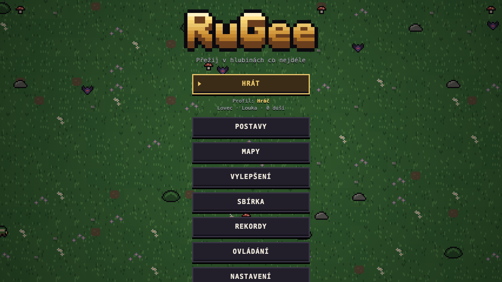
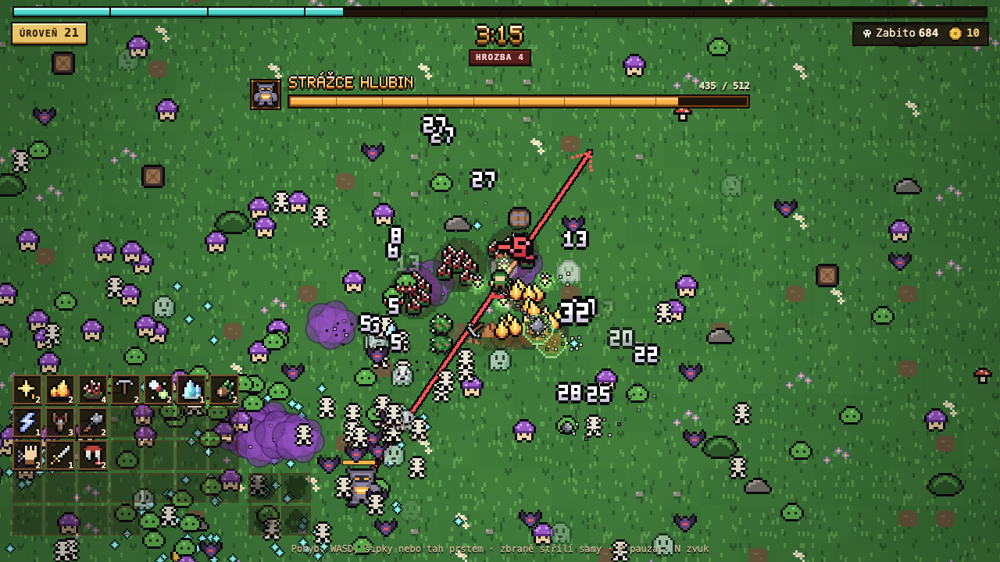
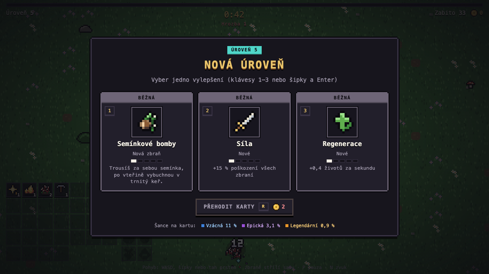

# RuGee – podrobný popis

Všechno, jak hra funguje do detailu. Krátké shrnutí je v [README](../README.md).

## ▶ [Hrát v prohlížeči](https://kojdad-alt.github.io/RuGee/)

Survivors hra v prohlížeči: ty se jen pohybuješ, zbraně střílí samy a na louku se valí hordy. Z krystalů roste úroveň a na každé si vybereš vylepšení. Každé 3 minuty přijde boss, pokaždé jiný, a každý má 2–3 schopnosti, které střídá: Strážce hlubin dupne, vyrazí výpadem a vyvolá kostlivce, Matka pavouků vyvolá pavoučky, hází kokony ze sítě a skáče výpadem, Kamenný obr hází 3–5 kamenů a dupe a Bludička se přenáší kolem tebe, střílí vějíře a vyvolá duchy. Před každou schopností se boss na 0,8 s zastaví, nad hlavou mu bliká vykřičník a je vidět, co přijde: pod Dupnutím roste rudý kruh (pak vyběhne rázová vlna, která zraní, odhodí a otřese obrazovkou), u Hodu zvedá kameny nad hlavu a po hodu je na zemi stín dopadu (po dopadu malý výbuch), u Výpadu míří čára, kudy proběhne, a u Vyvolání se rozzáří kruhy, ze kterých vylezou pomocníci. Pod polovinou životů boss zuří (v pruhu bliká ZUŘÍ) a střídá schopnosti rychleji. Schopnosti jsou data (`SCHOPNOSTI` a `BOSSOVE` v `src/hra.js`), další se přidá jedním záznamem. Pak to jde zase od Strážce. Každý živý boss má nahoře svůj pruh životů. Od 1,5 minuty bloudí průsvitní duchové, kteří letí rovně skrz tebe a občas na chvíli zmizí (schovaného ducha zbraně netrefí, ale ani on tebe). Od 2. minuty lezou pomalí houbáci, po kterých zůstane na 3 s fialový jedový oblak, ze kterého je lepší hned vylézt. Od 3. minuty chodí smečky 4–6 rychlých vlků a od 4. minuty pavouci, jejichž síť tě na chvíli zpomalí.

Hra nemá konec, jen je čím dál těžší. Pod časem nahoře je Hrozba: každou minutu stoupne o 1 a krátce se ohlásí. S ní mají noví nepřátelé víc životů, víc bolí a jsou rychlejší, chodí jich víc naráz a od 8. minuty to roste čím dál rychleji. Od 5. minuty se mezi nimi objevují elity (o třetinu větší, s rudým obrysem, pětkrát víc životů, za to velký krystal), od 10. minuty jich přibývá a bossové mají ještě víc životů. Celý vzorec je v jedné tabulce `HROZBA` v `src/hra.js`. Od 18. minuty to roste ještě o kus rychleji. Bez trvalých vylepšení se dá vydržet zhruba 8–12 minut, se vším vylepšeným (i se zlaťáky u kupce, s pasivami pro zbraně, pro přežití i s Pasivami II) zhruba 24–29.

Stačí kliknout na odkaz výš, nic se neinstaluje. Jde to i na mobilu (tah prstem).

Zbraně: Jiskra, Lucerna, Krumpáče, Blesk, Trnová past, Zrcadlový štít, Světlušky, Mrazivý krystal, Zvon hlubin, Cep na řetězu, Semínkové bomby, Kořeny, Ohnivá stopa a Odrazný kámen. Trnová past nechá pod nejbližšími nepřáteli vyrašit trsy trnů, které zraňují a zpomalí každého, kdo v nich stojí (bosse jen napůl). Zrcadlový štít krouží těsně kolem tebe: kdo se ho dotkne, dostane ránu a odletí, a střelu bosse pošle zpátky na toho, kdo ji vystřelil. Světlušky (na začátku 3) se vznáší v kroužku kolem tebe, odpočatá vyletí na nepřítele v dosahu (víc světlušek na různé nepřátele), obloukem k němu zatočí, zasáhne ho a vrátí se. Ve tmě jeskyně a hřbitova svítí. Mrazivý krystal každých pár sekund spadne do největšího hloučku nepřátel (kousek blíž k tobě, ať do něj vejdou), zóna kolem něj mrzne a zpomalí každého uvnitř čím dál víc (bosse napůl), před koncem praská a pak se roztříští: rána všem uvnitř a obyčejný nepřítel, kterému zbude nanejvýš 15 % životů, se roztříští rovnou. Zvon hlubin visí nad tebou a každých pár sekund odbije: od tebe se rozběhne zvuková vlna, každého, přes koho přejde, zasáhne, odhodí a omráčí (omráčený stojí, nad hlavou mu krouží hvězdičky a nekouše, boss jen zpomalí napůl a kouše dál). Chvíli po omráčení je nepřítel odolný a další vlna ho jen zraní. Od 4. úrovně přijde po první vlně ozvěna. Cep na řetězu je těžká koule: když stojíš, roztáčíš ji kolem sebe, když jdeš, táhne se za tebou a na zatáčkách se kývá. Čím rychleji koule letí, tím víc bolí (až dvojnásob), a kdo dostane ránu, odletí tím směrem. Od 4. úrovně máš druhou kouli na delším řetězu. Semínkové bomby: za sebou trousíš semínka (když stojíš, padají kolem nohou), po vteřině semínko blikne a vybuchne a na jeho místě vyroste trnitý keř, který píchá každého, kdo v něm stojí, a po pár sekundách zvadne. Kořeny: od tebe vyběhne kořen pod zemí (je vidět prasklá zem a hrbolek hlíny) za nejbližším nepřítelem, pod ním vyrazí, zraní každého kolem a drží ho: držený stojí (boss jde napůl), sebou škube, ani odhození s ním nehne a kořeny ho každou chvíli sevřou. Po puštění ho kořeny chvíli nechytí. Víc kořenů běží každý za jiným nepřítelem a když cíl cestou padne, kořen si najde jiný. Ohnivá stopa: kudy jdeš, tudy za tebou hoří cesta plamenů (vestoje hoří jeden pod nohama), kdo do ní vleze, toho oheň pálí, a od 4. úrovně ho zapálí, takže hoří ještě chvíli po vylezení. Ve tmě stopa svítí. Odrazný kámen: prak vystřelí kámen na nejbližšího nepřítele, kámen se od něj odrazí na dalšího nejbližšího a tak dál, každého zasáhne jen jednou a s každým odrazem letí rychleji a víc bolí. Když už nemá na koho, odletí pryč a spadne. Od skály se odrazí. Od 4. úrovně letí dva kameny na různé nepřátele.

Karty vylepšení mají raritu: Běžná (+1 úroveň), Vzácná (+2 úrovně), Epická (+2 úrovně a +5 % poškození) a Legendární (+3 úrovně, +10 % poškození a doléčení všech životů). Vzácnějších karet přibývá s časem a se Štěstím, truhla po bossovi dá vždy aspoň Vzácnou. Okno výběru ukazuje, jaká je zrovna šance na kterou raritu. Karty se vybírají klávesami 1–3, šipkami a Enterem, klikem nebo klepnutím.

Úrovně zbraní a pasiv nemají strop. Prvních 5 úrovní má každá zbraň vlastní (víc střel, rychlejší nabíjení…), každá další přidá +8 % poškození a každá třetí (8., 11., 14., …) ještě kus navíc, kratší nabíjení nebo větší dosah podle zbraně. Strop je jen tam, kde by se hra rozbila: nejvýš 12 kusů naráz (trsů trnů, zrcadel, krystalů a kořenů 8, semínek 6, ozvěn zvonu a koulí cepu 4), nabíjení nejvýš na čtvrtinu a dosah nejvýš 2,5× toho, co má zbraň na 5. úrovni. Pak roste už jen poškození. Pasivy od 6. úrovně přidávají menší díl (Srdce +10 životů, Boty +3 %, Magnet +10 %, Síla +5 %), Boty nejvýš 2× a Magnet nejvýš 8×, nad stropem dají +3 % poškození všech zbraní.

Pasivy pro všechny zbraně: **Kritický zásah** (+5 % šance za úroveň, že rána bolí dvakrát, ukáže se velké zlato-oranžové číslo s vykřičníkem; nejvýš 50 %), **Rozpětí** (+8 % velikost oblastí a dosah zbraní: světlo lucerny, kruhy krumpáčů a zrcadel, trsy, zóny, výbuchy, kořeny, plameny, řetěz cepu, přeskoky blesku i odrazy kamene; nejvýš 1,6×), **Ozvěna** (+6 % šance, že zbraň po výstřelu za chvilku vystřelí ještě jednou, krouživé a hořící zbraně zasáhnou podruhé, světluška se vrhne na dalšího, zvon přidá vlnu a ledová zóna se roztříští dvakrát; na místě se rozběhne fialový kroužek; nejvýš 50 %), **Výdrž** (+10 % trvání trsů, keřů, mrazu, omráčení, držení, plamenů a hoření, odhození doletí dál, jiskry a kameny letí déle, lucerna pálí i chvíli po vyjití ze světla a krumpáče, blesk a světlušky zasaženého na chvíli zbrzdí; nejvýš 2×), **Rychlé ruce** (−6 % nabíjení všech zbraní, nejvýš −40 %) a vzácný **Příval** (+1 kus všem zbraním: jiskra, krumpáč, blesk navíc, trs, zrcadlo, světluška, krystal, vlna zvonu, koule, semínko, kořen, kámen, u lucerny žhavý uhlík na okraji světla a u stopy další řada plamenů; nejvýš 3 úrovně, nabízí se asi třikrát méně často). Co z které zbraně pasivy čtou, je u zbraně v `ZBRANE.pasivy` (`src/hra.js`), kritické zásahy a ozvěny losují z vlastní řady (`losPasiv`), takže náhodu vln neposunou. Pasivy pro přežití: **Zbroj** (každá úroveň ubere 1 z každé rány od nepřátel, z dotyku, schopností bossů i jedového oblaku po houbákovi; aspoň 1 projde vždy, láva a bahenní oblaky bolí celé; strop nemá, rány s hrozbou ji pozdě stejně přerostou), **Regenerace** (+0,4 životů za sekundu za úroveň, nad hrdinou občas vyskočí zelené +N; nejvýš 4 za sekundu, ať se nedá přežít donekonečna) a **Štěstí** (+20 % šance za úroveň, že nepřítel pustí srdce nebo magnet; násobí se se Štěstím z trvalých vylepšení, karty ani výbavu nemění; nejvýš +200 %). Nad stropem dají jako ostatní +3 % poškození všech zbraní. Pasivy II: **Upíří zub** (+4 % šance za úroveň, že zabití nepřítele vrátí 1 život; od padlého ke hrdinovi doletí kapka krve a nad hrdinou je růžové +N; nejvýš 30 % a nejvýš 3 životy za sekundu), **Trnová zbroj** (kdo tě zraní dotykem nebo schopností, i boss ranou z dálky, dostane zpátky 50 % rány za úroveň, se Silou i kritickým zásahem, a z hrdiny přitom vyrazí trny; jedový oblak nikoho nemá; strop nemá), **Štít** (kolem hrdiny je modrá bublina, která zastaví celou jednu ránu od nepřátel, nad hrdinou vyskočí modrá 0 a bublina praskne; znovu se dobije za 20 s, každá další úroveň o 1 s dřív, nejrychleji za 8 s, a jak je dobitá, ukazuje oblouk kolem hrdiny; láva a bahno projdou), **Moudrost** (+5 % zkušeností z krystalů, násobí se s trvalými Zkušenostmi; nejvýš 1,6×) a **Chamtivost** (+10 % duší na konci hry, v rozpisu duší je zvlášť; nejvýš 2×). V přehledu výbavy vlevo dole je úroveň číslo v rohu ikony a rámeček zezlátne od 5. úrovně, od 10. je tyrkysový a od 15. rubínový.

Po každém bossovi zůstane jeho truhla (na zemi svítí v jeho barvě, mimo obrazovku k ní vede šipka). Když na ni šlápneš, svět se na vteřinu zastaví, truhla se otevře a vyletí z ní kus výbavy toho bosse, pak si ještě vybereš kartu aspoň Vzácnou. Výbava má čtyři sloty (Hlava, Tělo, Amulet, Prsten) a každý boss sadu čtyř kusů s vlastním jménem a staty (životy, zbroj, poškození, rychlost nabíjení, rychlost pohybu, dosah sběru). Kus má raritu jako karty, vzácnější je silnější a s hrozbou jich přibývá. Každý kus zapne efekt svého bosse: Strážce hlubin pošle každých 8 s od tebe rázovou vlnu, Matka pavouků občas zásahem zapřede nepřítele do sítě (stojí), Kamenný obr ti dá kamennou kůži (dotyk bolí míň a nepřítele odhodí) a Bludička tě po ráně na chvíli schová (nepřátelé jdou tam, kde jsi zmizel). Dva kusy stejné sady efekt zesílí a přidají bonus, čtyři ho zesílí naplno. Když už slot něco má, okno porovnání ukáže nový a nasazený kus vedle sebe s rozdíly (klávesa 1 Vzít, 2 Nechat) a kus, který si nenecháš, se rozloží na zlaťáky. Výbava platí jen v jedné hře, je vidět vpravo od zbraní vlevo dole. Všechno je v tabulce `VYBAVA` v `src/vystroj.js`.

Zlaťáky (nahoře vedle počtu zabitých) padají z bedniček, z elit (hromádka po třech) a občas z obyčejných nepřátel, magnet je přitáhne jako krystaly. Utrácí se třemi způsoby. Každé 3 minuty (poprvé ve 2:05, nikdy když žije boss nebo když má přijít) přijede na louku vůz kupce a 45 s stojí kousek za okrajem obrazovky, šipka na okraji ukazuje kam a kolik sekund mu zbývá. Když k vozu dojdeš, otevře se obchod (hra mezitím stojí): Lektvar léčení (polovina životů), Přehození karet (2× zdarma), Náhodné vylepšení (tvoje zbraň nebo pasiva, aspoň vzácná karta), Kus výbavy bosse (drahý) a Klíč. Ceny rostou s hrozbou o 12 % za stupeň (klíč ne), kupuje se klávesami 1–5 nebo klikem, Esc odejde. V okně nové úrovně jde karty přehodit (R nebo tlačítko pod kartami): první přehození stojí 2 zlaťáky a každé další o 2 víc, přehození od kupce jdou první a zdarma. Po louce se objevují zamčené truhly (mimo obrazovku k nim vede malá ikona), otevře je Klíč nebo 15 zlaťáků a uvnitř je volba karty aspoň Vzácné. Co po hře zbude, promění se v duše: 1 duše za každých 5 zlaťáků. Nepřátelé pustí nejvýš asi 20 zlaťáků za minutu (měšec `MESEC`), ať jich pozdě ve hře, kdy padají stovky elit, není tolik, že by nic nestálo za nic. Všechno je v `src/hra.js` (`KUPEC`, `ZBOZI`, `PREHOZENI`, `CENA_ZAMCENE`), okno obchodu v `src/obchod.js`.

Hra začíná v hlavním menu (Hrát, Postavy, Mapy, Vylepšení, Sbírka, Rekordy, Ovládání, Nastavení, Profil), vybírá se šipkami a Enterem, klikem nebo dotykem. Menu je dřevěná deska s rámem pod zlatým logem: nahoře velké mosazné Hrát, pod ním cedulka se zvoleným profilem, postavou, mapou a dušemi (každé s pixelovou ikonou, mapa kouskem své podlahy) a pod ní záložky ve dvou sloupcích (vlevo Postavy, Mapy, Vylepšení, Sbírka, vpravo zbytek; šipky jdou prvním sloupcem dolů a pak druhým). Otevřená záložka je ve stejném rámu s nadpisem pixelovým písmem. Za menu ujíždí zvolená mapa ztmavená do teplé hnědé; kdo má v systému zapnutý omezený pohyb, tomu pozadí stojí. Rekordy ukazují nejdelší přežití zvoleného profilu pro každou mapu zvlášť (každá mapa má destičku s ikonou své podlahy a datem, čas je velkým pixelovým písmem, vedle postava se spritem, hrozba, úroveň a zabití; zamčená mapa řekne, co ji odemkne) a Sbírka všechny kusy výbavy bossů, které jsi kdy našel (v nejlepší raritě, neobjevené jako stín). Sbírka má nahoře pruh, kolik kusů je objeveno, a každou sadu na destičce s truhlou jejího bosse: kusy 2×2 jako sloty výbavy ve hře, celá sada má mosazný rám a cedulku 4/4, dole bonusy za 2 a 4 kusy.

V Profilu může mít jeden prohlížeč až 5 profilů (třeba pro sourozence). Každý má vlastní duše, trvalá vylepšení, rekordy, sbírku, odemčené mapy, zvolenou postavu a mapu, Nastavení (zvuk, čísla poškození) je společné. Profily jsou pod sebou jako sloty uložení: karta profilu ukazuje postavu ve výklenku, duše, odemčené mapy, sbírku a nejdelší přežití, klik na kartu profil zvolí a hra si volbu pamatuje. Tlačítka pod kartami: nahoře Nový profil (začne od nuly), Přejmenovat (jméno má 1 až 16 znaků a dva profily nemůžou mít stejné) a Smazat (zeptá se a hlášení s mosaznou kontrolkou napíše, co všechno zmizí, druhý stisk smaže profil i se všemi daty, poslední profil smazat nejde), pod nimi Exportovat a Importovat. Podokna (nový profil, přejmenování, export, import) jsou ve skupině s pixelovým nadpisem, pole pro jméno a kód jsou zapuštěná do desky. Uložení z doby před profily jsou po prvním spuštění rovnou první profil Hráč: první profil používá původní klíče `hlubiny.*` v úložišti prohlížeče, takže se nic nekopíruje ani nemaže. Další profily mají klíče `hlubiny.p2.*` až `hlubiny.p5.*`, zvolený profil je v `hlubiny.profil` a profil existuje, když má zapsané jméno (`jmeno`). Rozbitý záznam hru neshodí: rozbité jméno se ukáže jako „Profil 2“, rozbitá data jako prázdná a rozbitý zvolený profil jako první existující. Kód je v `src/ulozeni.js`, okno v `src/menu.js`.

Profil se dá přenést do jiného prohlížeče nebo zařízení bez serveru. Exportovat ukáže kód uložení (jeden řádek textu, u běžného profilu kolem 300 znaků, ani s plnou sbírkou a rekordy na všech mapách nemá přes 1000), který jde zkopírovat tlačítkem nebo poslat zprávou, a nabídne soubor `RuGee-<jméno>.rugee` (řádek popisu a pod ním stejný kód). Importovat přijme vložený kód (klidně se zalomením nebo textem okolo) nebo vybraný soubor, nejdřív ukáže, co v kódu je, a pak ho nahraje jako nový profil, nebo přes existující (zeptá se, druhý stisk přepíše). Kód má tvar `RUGEE1.<data>.<součet>`: data jsou zkrácený JSON profilu v base64url, součet je CRC-32 a pozná překlep. Když kódu chybí konec (useknutý při kopírování), hra to řekne zvlášť, ať ho hráč zkopíruje celý znovu. Uvnitř se každá hodnota kontroluje stejně jako při čtení z úložiště (neznámá postava, mapa, vylepšení nebo kus sbírky se zahodí). Kód není šifrovaný, slouží jen k přenosu, a nic se nikam neposílá. Kód je v `src/prenos.js`.

V Mapách si vybereš, kde budeš hrát, a hra si to zapamatuje. Louka je zelená tráva s květinami a je odemčená hned. Jeskyně hlubin má tmavou kamennou podlahu, krápníky a krystaly ve skále, které svítí i ve tmě. Kolem hrdiny je vidět jen kruh světla, s Lucernou je větší a Lucerna tu má o 30 % větší dosah. Chodí tu víc netopýrů a pavouci už od 45 s, vlci ne. Zamrzlé jezero je sníh a velké plochy ledu, na kterých hrdina klouže: rozjíždí se pomalu, po puštění jede dál a zatáčí obloukem. Sněží, chodí tu vlci (sami i ve smečkách) a ledoví duchové. Sopka je černá skála s lávovými tůněmi: kdo v lávě stojí, toho pálí (každou půlsekundu rána s oranžovým číslem), vzduchem létají žhavé jiskry a nejčastěji tu lezou ohniví brouci, jejichž kousnutí pálí. V Bažině je bahno, ve kterém hrdina jde o 40 % pomaleji, a z bahna kolem tebe stoupají jedové bubliny: vteřinu je vidět zelený kruh, pak bublina praskne v jedový oblak. Skáčou tu žáby (chvíli sedí, pak skočí kus dopředu) a rostou houbáci. Hřbitov za noci je tmavý (kolem hrdiny je vidět, s Lucernou dál), přes hroby se plazí mlha a chodí kostlivci, duchové a později i vlci. Na všech mapách kromě Louky stojí překážky (krápníky a skály, smrky a kameny, čedičové skály a obsidián, mrtvé stromy a pařezy, náhrobky a kříže): hrdina ani nepřátelé jimi neprojdou, nepřátelé je obejdou a hrdina po nich sklouzne stranou. Duchové jimi proletí (nemají tělo) a střely přes ně přeletí (letí vzduchem). Překážky nikdy nestojí u startu, v lávě, v bahně ani na ledu a nikdy dvě vedle sebe, takže mezi nimi jde vždycky projít. Každá mapa má svého hlavního bosse, který přijde jako první (karta mapy ho ukazuje): na Louce Strážce hlubin, v Jeskyni Matka pavouků, na jezeře Bludička, na Sopce Lávový obr (hází magma, dupe a vyvolá ohnivé brouky), v Bažině Bahenní bludička (zelené vějíře a vyvolá žáby) a na Hřbitově Kostěný král (výpad, hází lebky a vyvolá kostlivce). Noví bossové vychází z Kamenného obra, Bludičky a Strážce, jejich truhla dá kus sady toho, z koho vychází. Další mapa se odemkne, když na té předchozí přežiješ 5 minut (zamčená mapa má v menu zámek a napíše, co chybí, a když už na předchozí mapě nějaký čas máš, pruh po minutách ukáže, kolik z 5 minut už jsi vydržel). Karta mapy má náhled v dřevěném okénku, hlavního bosse s jeho spritem a obtížnost s lebkou. Další mapy jsou čím dál těžší: v jeskyni, na jezeře a na sopce mají nepřátelé o 35–40 % víc životů a o 30 % víc bolí, v bažině o 50 % a 40 %, na hřbitově o 60 % a 45 %. Všechno o mapě (jméno, barva, dlaždice, ozdoby, překážky, mix nepřátel, smečky, hlavní boss, tma, led, láva, bahno, bubliny, jiskry, mlha, obtížnost) jsou data v `src/mapy.js`, podlahu z nich kreslí `src/louka.js`.

V Postavách si vybereš třídu a hra si ji zapamatuje: Lovec (Jiskra, rychlejší pohyb), Havíř (Krumpáče, víc životů), Světlonoš (Lucerna, větší dosah sběru) a Bouřlivák (Blesk, rychlejší nabíjení zbraní).

Po každé hře dostaneš duše: 1 za každých 20 s přežití, 1 za každých 20 zabitých, 10 za každého bosse a 1 za každých 5 nevyužitých zlaťáků, s pasivou Chamtivost ještě o její díl víc. Ve Vylepšeních si za ně kupuješ trvalá vylepšení, která platí od začátku každé další hry: Síla, Životy, Rychlost, Magnet, Štěstí (častěji padá srdce, magnet a vzácnější karty), Zkušenosti a Oživení (jednou za hru tě vrátí s půlkou životů). Každá další úroveň stojí víc. Karta vylepšení má ikonu (stejný sprite jako podobná pasiva ve hře), úrovně jako dílky a cenovku; když duše nestačí, cenovka napíše, kolik chybí, a koupené naplno má mosazný rám a Hotovo. Vrátit duše (v závorce kolik) zruší všechna vylepšení a duše ti vrátí, ať je můžeš rozdělit jinak; když není co vracet, tlačítko je vypnuté. Duše i vylepšení se pamatují jen v tomhle prohlížeči.

Ovládání: WASD nebo šipky, na mobilu tah prstem. P pauza (na mobilu tlačítko vlevo nahoře v liště), N ztlumí nebo zapne zvuk, R přehodí karty, u kupce 1–5 koupí a Esc odejde, po prohře R znovu a M menu.

Zvuk a hudba jsou celé ze syntezátoru prohlížeče (WebAudio), hra nestahuje žádný zvukový soubor. Zvuk se zapne tlačítkem Hrát (prohlížeč ho jinak nepustí). Každá zbraň má svůj krátký tichý zvuk (Jiskra cvrnká, Blesk praská, Krumpáče cinkají, Cep duní, Semínka bouchají, Mráz zvoní a tříští se…), ozve se zásah a smrt nepřítele, krystaly (při rychlém sbírání tón stoupá), zlaťák, srdce, magnet, bomba, rozbitá bednička, zranění, Štít, Oživení i smrt hrdiny. Bossové mají zvuk příchodu, zuřivosti a pádu a před každou schopností varování, které se dá poznat po sluchu: Dupnutí hluboce duní, Hod skřípe a hvízdá, Výpad vrčí čím dál výš, Vyvolání se tajemně chvěje a Vějíř se třpytí. Ozve se i truhla bosse, zamčená truhla, příjezd kupce a nákup, vyšší Hrozba, nová elita a odemčená mapa. Ve stovkách zásahů to nedrnčí: každý zvuk má nejkratší odstup a běžných zvuků zazní nejvýš 30 za sekundu (důležité, jako boss nebo varování, projdou vždy) a na výstupu je omezovač hlasitosti, takže nic neřve. Na pozadí hraje jemná hudba ve smyčce, každá mapa má svou náladu (Louka vesele, Jeskyně pomalu s kapkami a ozvěnou, Zamrzlé jezero zasněně, Sopka napjatě, Bažina zakaleně, Hřbitov strašidelně), s živým bossem zrychlí a přidají se bicí, v okně karet a v pauze hraje tišeji a po prohře utichne. V Nastavení (i v pauze) je hlasitost Efektů a Hudby po 10 % (0 % = vypnuto, výchozí 60 % a 40 %) a přepínač Zvuk (N), uloží se v prohlížeči. Pruh hlasitosti je zapuštěný s mosaznou výplní po dílcích a jezdcem na konci, na telefonu jsou − a + pod názvem po stranách pruhu přes celou šířku. Přepínače mají pixelovou kontrolku (zelená zapnuto, zhaslá rudá vypnuto). Nastavení i Ovládání mají skupiny na destičkách s nadpisem světlým pixelovým písmem (Ovládání: Pohyb, Ve hře, Menu a konec hry). Tam jsou i Čísla poškození.

## Vzhled

Téma oken je **důlní dřevo a mosaz**: okna jsou z trámů důlní výdřevy s mosazným kováním v rozích, uvnitř tmavá prkna a nadpisy zlatým pixelovým písmem jako logo. Barvy jsou z palety spritů (dřevo krumpáče, zlato loga, obrys spritů), nic se nestahuje. Ukázka celého kitu je na stránce [docs/tema.html](https://kojdad-alt.github.io/RuGee/docs/tema.html).

- **Barvy** jsou proměnné v `style.css`: `--noc` (obrys), `--drevo-0` až `--drevo-6`, `--mosaz-tma`, `--mosaz-stin`, `--mosaz`, `--mosaz-svetla`, `--mosaz-lesk`, `--pergamen` (text), `--pergamen-tlumeny`, `--ok`, `--chyba`. Barvy rarit (`.rarita-*`), zkušeností (`--xp`) a duší (`--duse`) jsou stejné jako ve hře. Staré šedé proměnné (`--panel`, `--okraj`, `--text`, `--text-tlumeny`, `--zlata`, `--pozadi`) už nejsou, celé UI je v kitu.
- **Rámy a deska** jsou pixel art z textu v `nastroje/ramy.mjs` (každý znak barva, jako sprity). Skript z nich udělá SVG a zapíše je do `style.css` jako `--ram-drevo`, `--ram-mosaz`, `--ram-tenky`, `--deska` a `--sipka`; po změně kresby `node nastroje/ramy.mjs` a pak `node nastroje/verze.mjs`. Okno dostane třídu `.ram` (dřevo) nebo `.ram ram-mosaz` (vzácné okno), menší rámeček uvnitř `.ram-tenky`, samotná prkna `.deska`. Rám je 9-slice přes `border-image`, takže se natáhne na jakoukoli velikost; jeden pixel rámu je `--px` (3 px, na telefonu 2 px), aby pixely zůstaly ostré.
- **Tlačítka** jsou `.menu-tlacitko`: dřevěná destička s obrysem a zkosenými rohy, světlá hrana nahoře, stín dole. Vybrané (šipky, myš i dotyk) má mosazný obrys, zlatý text a pixelovou šipku, stisk prohodí hrany. Varianty `.hlavni` (mosazné: Hrát, Pokračovat), `.potvrdit` (rudé, druhý stisk) a vypnuté. Barvy jdou z proměnných `--tl-*`.
- **Písmo**: text je systémové monospace, nadpisy oken kreslí `src/pismo.js` pixelovým písmem 5×7 se vší českou diakritikou (`pixelovyNadpis(prvek, text)`, text zůstane pro čtečky). Logo kreslí stejný modul svým tlustým písmem. Zvětšuje se jen celými násobky podle šířky okna.
- **Karty** voleb (Postavy, Mapy, Profil) jsou `.trida`, karty Vylepšení `.vylepseni` se stejným rámem a stavy: dřevěná destička v tenkém rámu, vlevo výklenek `.trida-portret` se spritem stojícím na prkně podlahy. Vybraná karta má mosazný obrys, světlejší dřevo (`--karta-vybrana`) a stejnou pixelovou šipku jako tlačítka, zvolená mosazné kování a cedulku Zvoleno. Rámečky karet jsou v `nastroje/ramy.mjs` (`--ram-karta-vybrana`, `--ram-karta-zvolena`, `--ram-karta-zvolena-vybrana`). Na kartě postavy je u startovní zbraně její ikona.
- **Karty odměn** (nová úroveň, truhla bosse) jsou `.karta`: dřevěná destička s pixelovým rámečkem a kovovým pruhem v barvě rarity (barvy rarit zůstávají jako ve hře), ikona ve výklenku a úrovně jako zapuštěné dílky. Vzácné, epické a legendární karty mají kolem pixelovou záři ve dvou stupních, která pulzuje po krocích (bez rozmazání). Vybraná karta má světlý rámeček i pruh, mosazný lem a v pruhu stejnou šipku jako tlačítka. Okno nové úrovně má rám z trámů, truhla bosse mosazný, nadpis pixelovým písmem a šance na rarity v zapuštěné liště s pixelovými drahokamy. Porovnání výbavy je mosazné okno: nový kus vlevo, nasazený vpravo, mezi nimi mosazné šipky výměny (`--vymena` z `nastroje/ramy.mjs`) se jménem slotu a dole na kartě destička Vzít / Nechat, která je na vybrané kartě mosazná. Při otevírání truhly se jméno kusu objeví na tmavé dřevěné cedulce pixelovým písmem v barvách rarity. Obchod kupce je taky mosazné okno: nahoře zapuštěná pokladnička se zlaťáky a klíči, zboží jsou karty s mosazným rámečkem a mosaznou cenovkou místo pruhu rarity a dole zapuštěné počítadlo kusů na voze. Na co zlaťáky nestačí, má tmavou cenovku s cenou v barvě chyby, a po nákupu se ukáže hlášení se zelenou kontrolkou.
- **Pauza** je okno z trámů s pixelovým nadpisem a kolem sebe má teplý závoj přes hru (obří stín okna), aby se dalo číst i přes hordu. Pod mosazným Pokračovat jsou volby ve skupinách jako v Nastavení: Hra (čísla poškození) a Zvuk (hlasitost a ztlumení). Vysoké okno se na nízké obrazovce posouvá.
- **Konec hry** je okno z trámů se závojem jako pauza. Nad nadpisem je štítek s rekordem (nový rekord mosazný, jinak tmavá cedulka s rekordem mapy) a nadpis Horda tě pohltila je krvavě rudým pixelovým písmem (`STYL_KREV` v `src/pismo.js`). Pod ním je přehled běhu: vlevo čas velkým pixelovým písmem, vpravo zapuštěná tabulka (postava a mapa s ikonou, hrozba, úroveň, zabití, bossové, výbava), pod ní poznámky (oživení, odemčená mapa). Dole je pokladnička s dušemi za hru a mosazné Znovu vedle Menu.
- **Horní lišta (HUD)**: zapuštěný pruh zkušeností s leskem a dílky po desetinách, vlevo mosazná cedulka s úrovní (na dotykovém displeji před ní dřevěné tlačítko pauzy se dvěma mosaznými sloupky, klávesy P a Esc tam nejsou), uprostřed čas pixelovým písmem (kreslí se jen při změně, text zůstává v prvku pro čtečky i natáčení) a pod ním rudá cedulka hrozby, vpravo zapuštěná destička se zabitými (lebka), zlaťáky a klíči. Na telefonu má lišta kratší popisky a nic se nelámе. Nápověda dole a pata menu mají na dotykovém displeji vlastní text bez kláves a tlačítka (Zpět, Pokračovat, Znovu, Menu, Odejít, Zvuk, Přehodit karty) tam neukazují klávesové zkratky (`.jen-klavesnice`). Pruhy bossů začínají pod skutečným spodkem lišty (`kresli(..., { horni })`), mají zapuštěný pruh v barvě bosse, portrét s mosaznými nýty a na širší obrazovce jméno pixelovým písmem v barvě bosse. Nápis uprostřed (příchod bosse, kupec) je zlatým pixelovým písmem a ohlášení hrozby krvavým na tmavé liště; dlouhý nápis na úzké obrazovce zůstává obyčejným písmem. Přehled výbavy vlevo dole má zapuštěné dřevěné jamky, hlášení zvuku (N) je dřevěná cedulka.
- **Drobnosti**: `.stitek` (mosazná cedulka), `.pruh-postupu` (zapuštěný pruh s mosaznou výplní a dílky podle `--dilku`, v Mapách po minutách, ve Sbírce po kusech), `.prohlubne` (zapuštěné pole nebo pruh), `kbd` (dřevěná klávesa), `.jen-ctecka` (text jen pro čtečky).

Test hlídá, že každý znak písma má stejný tvar, česká písmena mají diakritiku nad základním písmenem, všechny nadpisy oken z `index.html` i záložky menu jdou napsat a logo má všechna písmena.

## Aplikace a hraní bez internetu

Hra je PWA: v Chromu a Edgi (Android i počítač) jde nainstalovat, v Safari na iPhonu přidat na plochu (Sdílet → Přidat na plochu), otevře se přes celou obrazovku s vlastní ikonou a po první návštěvě jde hrát i bez internetu.

- **Přidat na plochu** (`src/aplikace.js`): kde prohlížeč instalaci nabízí (`beforeinstallprompt`), je pod záložkami menu tlačítko Přidat na plochu, které otevře jeho nabídku. Na iPhonu tlačítko otevře Nastavení se skupinou Na plochu a návodem pro Safari. Z plochy a v prohlížečích bez instalace se tlačítko neukáže, skupina Na plochu v Nastavení jen napíše, kde instalaci hledat, a jestli je hra uložená pro hraní bez internetu.
- **Ikony** kreslí `nastroje/ikony.mjs` z pixel artu hry: Havíř ze `src/sprity.js` s obrysem jako ve hře, za ním světlo lucerny ve dvou stupních dřeva, prkna a rám okna z `nastroje/ramy.mjs`. PNG zapisuje vlastním malým kodérem (`node:zlib`), každý bod kresby je celý čtverec, takže ikony jsou ostré: `ikona-192.png` a `ikona-512.png` (rám okna), `ikona-maska-512.png` (maskovatelná, prkna do krajů a Havíř v bezpečném kruhu), `ikona-apple-180.png` (plocha iPhonu) a `ikona-32.png` (záložka prohlížeče). Po změně spritu nebo rámu: `node nastroje/ikony.mjs` a pak `node nastroje/verze.mjs`.
- **Manifest** `manifest.webmanifest`: jméno RuGee, start a rozsah `./` (funguje pod `/RuGee/` na GitHub Pages i lokálně), celá obrazovka, barva `--noc`.
- **Service worker** `sw.js` při instalaci stáhne celou verzi (stránku, styl, všechny moduly s otisky, manifest a ikony) do keše `rugee-<VERZE>` mimo HTTP keš prohlížeče a hned se aktivuje, aktivace smaže keše starých verzí. Stránka jde vždycky nejdřív ze sítě (mimo HTTP keš), takže první načtení po nasazení je nová verze; z keše se vezme jen bez sítě nebo když síť do 4 s neodpoví. Skripty a styl mají v adrese otisk, takže se berou z keše, a co v ní ještě není, jde ze sítě. Cizí adresy a jiné stránky (třeba `docs/`) nechává prohlížeči.
- **Nová verze nezůstane viset**: `node nastroje/verze.mjs` zapíše do `sw.js` seznam souborů a `VERZE` = otisk stránky, stylu, modulů, manifestu a ikon, takže každá změna změní i `sw.js`. `aplikace.js` ho registruje s `updateViaCache: 'none'` (prohlížeč si `sw.js` stahuje vždy ze sítě) a na novou verzi se ptá hned po načtení a po každém návratu do hry z pozadí. Když nová verze převezme stránku, která běží se starými soubory (moduly z import mapy v keši nové verze nejsou), stránka se sama obnoví, ale jen v hlavním menu, ne uprostřed hry, v záložce ani při psaní; jinak počká na návrat do menu.

Na vlastním počítači (`localhost`, `127.0.0.1`) se service worker registruje jen s `?offline` v adrese (http://localhost:8000/?offline), jinak by dával moduly z keše a změna bez `verze.mjs` by nebyla vidět; bez `?offline` se případný starý worker odregistruje.

Test hlídá manifest a ikony (PNG pixel po pixelu podle `ikony.mjs`), odkazy v `index.html`, že `sw.js` má verzi a seznam souborů přesně podle `verze.mjs` (zapomenuté `verze.mjs` test shodí) a service worker v náhradním prostředí s falešnou keší a sítí: instalace, mazání starých keší, stránka ze sítě a bez sítě nebo při pomalé síti z keše, soubory hry z keše a cizí adresy nechá být. V prohlížeči (Playwright, Chromium) je ověřené, že hra jde nainstalovat (Chromium nehlásí žádnou chybu instalace), bez sítě se načte a hraje, nová verze se v menu sama načte, uprostřed hry ne, první otevření po nasazení je nová verze i se serverem, který posílá `Cache-Control: max-age=600` jako GitHub Pages, a bez sítě je pak taky nová.

## Pro vývoj

Čistý HTML, CSS a JavaScript bez build kroku. Spuštění u sebe:

```bash
python3 -m http.server 8000
```

Pak otevři http://localhost:8000.

## Test

Simulace hry bez prohlížeče (Node 18+):

```bash
node tests/simulace.mjs 1 600
```

Jednoduchý hráč utíká od nepřátel, sbírá krystaly a na úrovni bere nejdřív zbraně do 5. úrovně, pak pasivy do 5. úrovně a pak zase zbraně. Test spadne, když se objeví NaN, nikdo nezemře, nepřátel přibývá bez konce, po zabití nevyletí úlomky, po zásahu hrdiny se neotřese obrazovka, pavouk přijde před 4. minutou, hrdina v síti nezpomalí, se špatně ukládá rekord nebo zvolená třída (kratší hra rekord přepíše, rozbitý záznam nebo zakázané úložiště spadne) nebo když některá třída nezačne se svou zbraní a výhodou. Hlavní hra je za výchozí třídu (Lovec) bez trvalých vylepšení, každá třída pak ještě 3 minuty hraje sama. Hlídá i duše: hra s prázdnými nebo rozbitými vylepšeními musí dopadnout úplně stejně jako bez nich, každé vylepšení změní svou vlastnost, Oživení vrátí hrdinu jen jednou, obchod nepustí nákup bez duší ani nad maximum, Vrátit duše vrátí přesně utracené a rozbitý záznam duší hru neshodí. U nových nepřátel hlídá, že duch, houbák ani vlk nepřijdou dřív, schovaného ducha nic nezasáhne a on nezraní, duch proletí skrz, oblak se nejdřív nafoukne, pak pálí a za 3 s zmizí, vlci chodí jen ve smečkách po 4–6 a jsou nejrychlejší. Bot se jedovým oblakům vyhýbá. U rarit hlídá, že losování sedí se šancemi, s časem a Štěstím přibývá vzácnějších karet, truhla nedá běžnou, karta přidá vždy celý počet úrovní své rarity a dá přesně slíbené úrovně, poškození a doléčení. U úrovní bez stropu hlídá každou zbraň až do 200. úrovně (každá úroveň víc poškození, každá třetí ještě něco, dokud to jde, nic přes strop, karta píše, co úroveň opravdu přidala), pasivy do 60. úrovně, že nabídka nikdy nedojde a že se všemi zbraněmi na 60. úrovni hra 30 s běží bez chyby. U bossů hlídá, že chodí po 3 minutách ve správném pořadí a každý se svým nápisem a spritem aspoň 16×16, že každý živý boss má svůj pruh, že každý má 2–3 schopnosti s varováním kolem 0,8 s, při kterém stojí a nikomu neublíží, a že každá schopnost funguje (dupnutí trefí jen v kruhu, odhodí a otřese obrazovkou, hod hodí 3–5 kusů a mine toho, kdo po hodu uteče, výpad sleduje hrdinu až do zamčení a mine toho, kdo pak uhne, vyvolání přivolá 6–8 pomocníků a nikdy přes limit, vějíř Bludičky vystřelí dvakrát), že je střídá dokola a pod polovinou životů rychleji, že stojícího hrdinu umí zranit a že každého jde porazit. U Trnové pasti hlídá, že trs vyraší pod nepřítelem (víc trsů každý jinde, za dosahem nic), než doroste, neškodí, pak zraňuje a zpomalí a zpomalení po vylezení dozní. U Zrcadlového štítu, že odhodí, koho se dotkne (bosse ne, schovaného ducha vůbec), a že vrácená střela zraní nepřítele, ne hrdinu, a proti Bludičce hrdinu trefí méně střel. U Světlušek, že jich je tolik, kolik slibuje úroveň, létají tam a zpátky a zraňují, každá letí na jiného nepřítele, za dosah ani na schovaného ducha nevyletí, bez cíle se všechny vrátí a běžícího hrdinu roj neztratí. U Mrazivého krystalu, že dopadne do hloučku (ne na osamělého nepřítele), během pádu nic nedělá, pak zpomalí přesně o svůj díl (bosse napůl) a zpomalení dozní, roztříštění složí hlouček, obyčejného nepřítele s malým zbytkem životů roztříští rovnou a bosse ne, víc krystalů padne každý jinam a nikdy jich není víc, než unese `MAX_ZON`. U Zvonu hlubin, že vlna zasáhne jen v dosahu a každého jednou, odhodí ho a omráčí (omráčený stojí a nekouše, boss jde napůl a kouše), ozvěna přijde po první vlně a odolného nepřítele jen zraní, další zvonění už zase omráčí a schovaného ducha vlna mine. U Cepu, že vestoje koule krouží na délku řetězu, za chůze se táhne za hrdinou a nikdy není dál než řetěz, zraní, přes koho se převalí, rána roste s rychlostí, víc koulí má každá jiný řetěz a ani na 200. úrovni se nic nerozbije. U Semínkových bomb, že semínko padne za hrdinu, do vteřiny nic nedělá, pak vybuchne jen v poloměru, keř píchá každý tik a zvadne, vestoje padají semínka každé jinde, víc semínek leží vedle sebe a semínek s keři není nikdy víc, než unese `MAX_SEMINEK`. Výsledek (`zvon_cep_seminka`) vypíše zvonění, omráčení, zásahy cepem a výbuchy semínek v hlavní hře i se vším na 60. úrovni. U Kořenů hlídá, že kořen běží pod zemí za nepřítelem rychlostí RYCHLOST_KORENE, pod ním vyrazí, zraní ho a drží (držený stojí, odhození s ním nehne, boss jde napůl), sevře ho každý tik, po puštění je nepřítel chvíli odolný a pak ho kořeny chytí znovu, za dosahem ani schovaného ducha nechytí, víc kořenů míří na různé nepřátele a kořen si po padlém cíli najde jiný. U Ohnivé stopy, že za běžícím hrdinou zůstanou plameny s rozestupem, vestoje hoří jen jeden pod nohama, kdo stojí v několika plamenech, toho pálí jen jednou za tik, oheň dohoří, od 4. úrovně zapálí a zapálený hoří přesně svůj čas, a schovaného ducha nepálí. U Odrazného kamene, že se v řadě kostlivců odrazí přesně tolikrát, kolik slibuje úroveň, s každým odrazem víc bolí a letí rychleji, za skok nedoletí a bez cíle spadne, dva kameny letí na různé nepřátele a od překážky na mapě se odrazí a nikdy v ní není. Kořeny, stopa a prak hrají ještě každý sám na 60. úrovni a nikdy nepřelezou své limity. Výsledek (`korene_stopa_prak`) vypíše držení, plameny, zapálení a odrazy v hlavní hře i na 60. úrovni. Výsledek ukazuje i souboje s každým bossem sám na sám a uprostřed vln, s uhýbáním a bez něj (kolikrát trefila která schopnost), a bot se schopnostem bossů vyhýbá jako člověk, který je vidí. U hrozby hlídá, že je to 1 + celé minuty a každé zvýšení se ohlásí, že na začátku nic nezesílí a nic časem neubývá, že noví nepřátelé mají životy, poškození a rychlost podle tabulky (elita víc, boss nikdy elitou), že elity nepřijdou před 5. minutou a po 10. jich přibude, že jedový oblak pálí s hrozbou víc a že v 60. minutě hra běží dál s konečnými čísly. Plně vylepšený bot pak hraje až do konce a musí padnout do 30 minut; výsledek (`hrozba.preziti_min`) ukazuje, jak dlouho vydržel on a jak dlouho hlavní hra bez vylepšení. U výbavy bossů hlídá, že každý boss má sadu 4 kusů se sprity 8×8 a truhlu ve svých barvách, že se truhla otevírá vteřinu a svět mezitím stojí, že dá kus od toho bosse (do volného slotu ho nasadí, u obsazeného čeká porovnání a nechaný kus dá zlaťáky), že staty sedí s raritou a sundaný kus vrátí hrdinu přesně zpátky, že bonusy sad platí od 2 a 4 kusů, že každý efekt dělá, co slibuje, a že Sbírka v úložišti drží nejlepší raritu a rozbitý záznam ji neshodí. Bot jde pro truhlu a bere kus s lepšími staty, výsledek (`vybava_bossu`) vypíše nalezené kusy, rozhodnutí a kolikrát který efekt zabral. U zlaťáků hlídá, že kupec přijede v čas (ne s živým bossem ani těsně před ním), stojí za okrajem obrazovky 45 s a odjede, že u vozu se otevře obchod a hra stojí, že bez zlaťáků se nekoupí nic, ceny rostou s hrozbou (klíč ne), zásoba dojde a každé zboží dělá, co slibuje, že přehození stojí čím dál víc a zdarma se bere první, že zamčenou truhlu otevře klíč nebo 15 zlaťáků (zbraně ji nerozbijí) a dá kartu aspoň Vzácnou, že elita nechá hromádku, měšec drží strop a magnet zlaťáky přitáhne a že z 5 zlaťáků je po hře duše. Bot zlaťáky sbírá, chodí ke kupci, když má na něco (lektvar jen zraněný, pak kus výbavy, vylepšení, klíč), otevírá zamčené truhly a přehazuje karty, když v nabídce nic nechce. Výsledek (`zlataky`) vypíše, kolik odkud přišlo, za co se utratilo, co koupil a kolik zbylo na duše. U map hlídá, že hlavní hra (Louka) je stejná jako před mapami, že každá další mapa se dohraje celá stejným botem, chodí na ní jen druhy z jejího mixu (a bossové s pomocníky), každý až od svého času a s ohlášením, smečky jen kde jsou, že na ledu hrdina klouže a na sněhu ne, led tvoří souvislé plochy kolem třetiny jezera a v jeskyni má lucerna větší dosah. Rekordy se ukládají pro každou mapu zvlášť (Louka pod starým klíčem), další mapa se odemkne 5 minutami na předchozí a zamčená nebo rozbitá zvolená mapa se načte jako Louka. U překážek hlídá, že nejsou na Louce, u startu, na zvláštní ploše ani vedle sebe, že hrdina ani nepřátelé (kromě duchů) v nich během celé hry nikdy nestojí, že kostlivec přímo za překážkou ji obejde a dojde k hrdinovi, duch jí proletí, hrdina jdoucí přímo na ni sklouzne kolem a střely hrdiny i bosse přes ni přeletí. Na Sopce hlídá, že láva pálí každou půlsekundu a skála vedle ne, v Bažině, že bahno zpomalí přesně o svůj díl, bubliny rostou jen v bahně v dosahu, prasknou v oblak a ten pálí až po nafouknutí, a že žába skáče. U bossů map hlídá, že na Louce je pořadí beze změny, na každé mapě přijde první její hlavní boss, každý z nových bossů má 2–3 schopnosti, vlastní jméno, nápis a sprite a jeho truhla dá kus sady toho, z koho vychází. Bot se lávě, bublinám a bahnu vyhýbá a z bahna jde k nejbližšímu kraji. Na ledu a v bahně s nepřítelem na zádech utíká mezerou jedním směrem: test hlídá, že necuká, z bahna s netopýrem na zádech vyjde do 2,5 s, na ledu s vlkem se do 1,5 s rozjede aspoň o 60 px a že tři hry, které v analýze balancu padly do 1:30 (semínko 3: Havíř v Bažině, Havíř a Světlonoš na Zamrzlém jezeře), teď 1:30 vydrží. Výsledek (`mapy`) vypíše přežití, úroveň a zabité pro každou mapu, kolik je překážek, jak rychle je kostlivec obešel, kolikrát pálila láva, kolik bylo bublin a jak skáče žába. U pasiv pro zbraně hlídá, že každá zbraň čte Rozpětí, Výdrž i Příval (čísla, která opravdu má) a že je mění přesně o slíbený díl, že bez pasiv jsou čísla zbraní stejná jako dřív, že Rychlé ruce zrychlí každou zbraň, že kritický zásah bolí dvakrát se zlatým číslem a padá s danou šancí, že Příval se nabízí zřídka a nad 3. úrovní dá poškození, že lucerna s Výdrží pálí i mimo světlo, a každá zbraň sama se všemi pasivami 15 s od 10. minuty musí mít ozvěny, kritické zásahy, delší efekty a kusy z Přívalu opravdu ve hře. Výsledek (`pasivy_zbrani`) to vypíše pro každou zbraň. U pasiv pro přežití hlídá, že Zbroj zmenší ránu kostlivce i jedového oblaku přesně o svůj počet a nejvýš na 1 (červené číslo ukáže zmenšenou ránu), z bahenního oblaku ani z lávy nic neubere, že Regenerace vrátí přesně svůj počet za sekundu, nepřeleze plné životy, zelené číslo ukáže nejvýš jednou za 1,5 s a na stropu dál neroste, a že Štěstí ze stejných losů dá víc srdcí a magnetů, nad stropem už ne, s trvalým Štěstím ještě víc a šance rarit karet nezmění. Výsledek (`pasivy_preziti`) vypíše, kolik poškození Zbroj zastavila a kolik životů Regenerace vrátila v hlavní hře i u plně vylepšeného bota. U Pasiv II hlídá, že Upíří zub léčí s šancí podle úrovně, vždy přesně 1 život, jen zraněného, nejvýš 3× za sekundu, kapka krve doletí a zmizí, růžová čísla se sčítají a náhodu vln neposune; že Trnová zbroj vrátí útočníkovi přesně svůj podíl rány (z rány před Zbrojí, se Silou, i bossovi z rázové vlny) a jedovému oblaku nic; že Štít je hned po vybrání hotový, zastaví celou ránu s modrou 0, další rána projde, dobije se přesně za 20 s, úrovně dobíjení zkracují až po 8 s (i rozběhnuté) a bahno ho nespotřebuje; že Moudrost dá z krystalu přesně o svůj násobek víc zkušeností a Chamtivost víc duší (jen celé, rozbité číslo nic nezmění). Se všemi pěti ve hře od 10. minuty musí sání, trny i zastavené rány opravdu nastat. Výsledek (`pasivy_ii`) to vypíše i pro hlavní hru a plně vylepšeného bota. Test profilů: stará uložení (klíče `hlubiny.*`) jsou po prvním spuštění profil Hráč a nic se v nich nezmění, druhé spuštění nic nepřidá, nový profil je prázdný a hra za něj nesáhne na jiný profil (ani obráceně), nastavení je společné a zvolený profil se pamatuje. Jméno nesmí být prázdné ani obsazené, dlouhé se zkrátí, víc než 5 profilů nejde (ani importem), smazání odstraní všechna data profilu a poslední smazat nejde. Export → import dá přesně stejná data (i ze souboru a z textu se zalomením), plný profil má kód do 1000 znaků, poškozený, useknutý, cizí nebo novější kód se odmítne a kód s nesmysly uvnitř pustí jen platné hodnoty. Import do nového profilu dá jméno s číslem (Hráč 2), import přes profil smaže rekordy, které kód nemá. Rozbité jméno, data nebo zvolený profil ani zakázané či chybějící úložiště nic neshodí. Test zvuku: bez AudioContext (v Node) se nic nerozbije a nevznikne žádný uzel, s náhradním AudioContextem, který jen počítá uzly, omezovač pustí stejný zvuk nejvýš jednou za jeho odstup a běžných zvuků nejvýš 30 za sekundu, zbraně na 60. úrovni nevytvoří moc uzlů za sekundu, hudba má každá mapa a s bossem je hustší, po pauze nedohání zmeškané noty, ztlumení a 0 % nic nevytvoří, hlasitosti se uloží a rozbitý záznam dá výchozí 60 % a 40 %. Hra hlásí zvuky jen známými jmény a každá zbraň má svůj zvuk.

## Balanc

```bash
python3 nastroje/balanc.py
```

Nástroj pustí simulaci za každou postavu na každé mapě s několika semínky naráz (stejný bot jako test, bez trvalých vylepšení) a z výsledků vygeneruje grafy `docs/balanc/*.svg`, data `docs/balanc/souhrn.json` a stručné čtení [BALANC.md](BALANC.md): přežití podle postavy a mapy, růst Hrozby, zabití za minutu a kdy přicházejí elity a bossové. Stačí Python 3.9+ (jen standardní knihovna) a Node. Výchozí běh je 6 semínek po 15 minutách, tedy 144 her, na 8 jádrech zhruba 5–7 minut. Volby: `--seminek 3`, `--od 10` (první semínko), `--sekund 600`, `--tridy lovec,havir`, `--mapy louka,sopka`, `--vylepseni max` (bot se všemi trvalými vylepšeními), `--procesu 4`, `--vystup jinam` (jinak se přepíše `docs`) a `--z-dat docs/balanc/souhrn.json` (jen překreslí grafy a BALANC.md bez simulace). Když ve výstupu už souhrn je a parametry sedí, vypíše, jak se medián přežití změnil proti minulému běhu. Po změně balancu (Hrozba, nepřátelé, zbraně, bossové) ho pusť znovu a commitni i nové grafy, BALANC.md ukazuje otisk kódu, ze kterého data jsou.

Hry, které v analýze skončí podezřele brzy (BALANC.md je vypíše pod 1:30), stojí za to přehrát se `--json` a podívat se, jestli je to chyba hry, nebo bota. Tak se našlo, že Havíř v Bažině padal za 28 s na 1. úrovni a Havíř se Světlonošem na Zamrzlém jezeře za 1:12: hra byla v pořádku, ale bot si nevěděl rady s nepřítelem na zádech. V bahně jde hrdina 66 px/s a netopýr i žába 72, na ledu se rozjíždí pomalu, a bot utíkal od každého nepřítele zvlášť, takže se útěky od nepřátel na všech stranách vyrušily a on cukal sem a tam na místě (na ledu se tak nerozjel vůbec). Bahnu se navíc vůbec nevyhýbal. Teď na ledu a v bahně utíká mezerou (zkusí 16 směrů a vezme ten s nejmíň nepřáteli po cestě a bez bahna, lávy, oblaků a překážek, drží ho 0,3 s a stejný směr má pak přednost), z bahna jde k nejbližšímu kraji, bahnu se vyhýbá slaběji než lávě a na ledu utíká od nepřátel z místa, kam ho led za 0,4 s donese. Na pevné zemi útěk mezerou nepoužívá: tam nepřítele na zádech předběhne a krumpáče mezitím sekají kolem (útěk mezerou všude zhoršil Havíře v Jeskyni hlubin). Z lávy ke kraji netáhne (na Sopce s tím vydržel méně), takže Louka, Jeskyně, Sopka i Hřbitov hrají stejně jako dřív.

Jednu hru se strojovým výstupem pustí i sama simulace: `node tests/simulace.mjs 3 900 --json --trida havir --mapa sopka` vypíše jeden řádek JSON (výsledek, průběh po minutách, příchod a pád každého bosse), `--vylepseni max` zapne všechna trvalá vylepšení a `--json --seznam` místo hry vypíše postavy, mapy, bossy a sílu hrozby po minutách. Bez `--json` běží test úplně stejně jako dřív.

## Ukázky

  

```bash
python3 nastroje/ukazky.py
```

GIF v README a tři screenshoty v `docs/ukazky/` (menu, boj a okno nové úrovně) dělá `nastroje/ukazky.py`. Pustí hru na lokálním serveru a `nastroje/natoc.mjs` ji v Chromiu bez okna (Playwright) nechá hrát jednoduchým botem: utíká od nepřátel, sbírá krystaly, na úrovni bere nejdřív zbraně, od kupce hned odejde a po prohře dá Znovu. Stav hry vidí přes jeden řádek připsaný jen do natáčené kopie `src/main.js`, soubor v repu se nemění. Natáčí se 230 s se semínkem 1, aby přišel i první boss. Snímky jdou z prohlížeče v PNG rovnou do ffmpeg: celá obrazovka do `video.mkv`, střed kolem hrdiny bezeztrátově do `stred.mkv` (vestavěné video Playwrightu pixel art rozmaže a GIF z něj vyjde čtyřikrát větší). Python pak spočítá, jaká část výřezu se mezi snímky změní, a vezme nejakčnějších 6 s, ve kterých není žádné okno ani cuknutí. Výřez se drží kolem hrdiny a vyhne se horní liště, přehledu výbavy i nápovědě. GIF má vlastní paletu bez rozptylu barev, takže pixely zůstanou ostré; kdyby měl přes 4 MB, zkusí méně snímků, méně barev nebo kratší úsek. Fotka boje je ta z nejakčnější chvíle, okno úrovně první po 40 s hry. Do `docs/ukazky/ukazky.json` se zapíše otisk kódu, úsek videa, čas ve hře a velikosti souborů.

Potřebuje Python 3.9+ s Pillow, Node, ffmpeg a Playwright s Chromiem (`npm i playwright && npx playwright install chromium`, nebo `PLAYWRIGHT_MODUL=/cesta/k/node_modules/playwright`). Volby: `--sekund 120`, `--seed 3`, `--delka 5`, `--max-mb 3`, `--vystup jinam` (jinak se přepíše `docs/ukazky`), `--prace slozka` (natočení si nechá) a `--z-natoceni slozka` (nenatáčí, jen znovu vybere úsek a udělá výstup). Ukázky přegeneruj po větší změně vzhledu a commitni je; každá nová verze GIFu přidá do historie repa pár MB, tak ne po každé drobnosti.

## Nová verze

Po každé změně kódu spusť `node nastroje/verze.mjs`. Do `index.html` zapíše otisky souborů (`?v=…`), aby hráči po nasazení nedostali z cache starý modul, a do `sw.js` novou verzi se seznamem souborů pro hraní bez internetu (viz [Aplikace](#aplikace-a-hraní-bez-internetu)).
